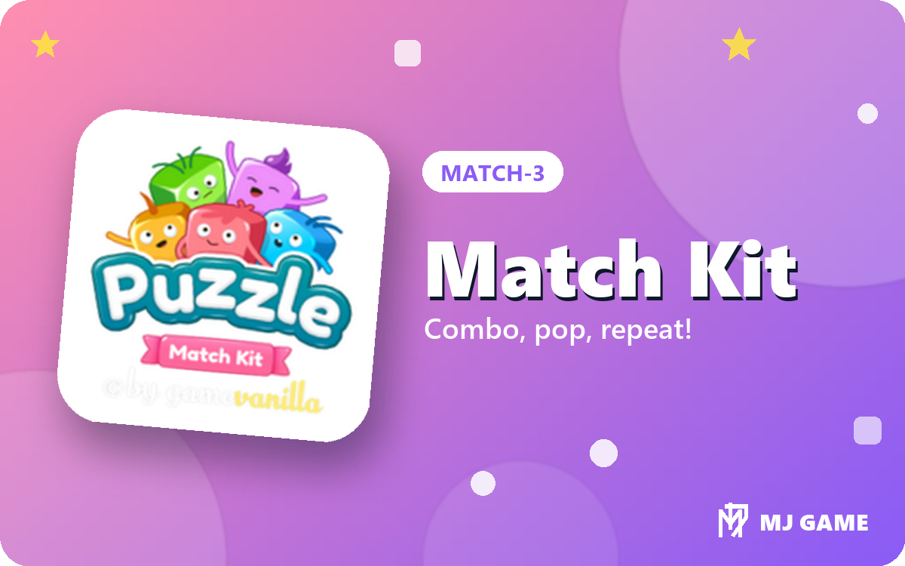
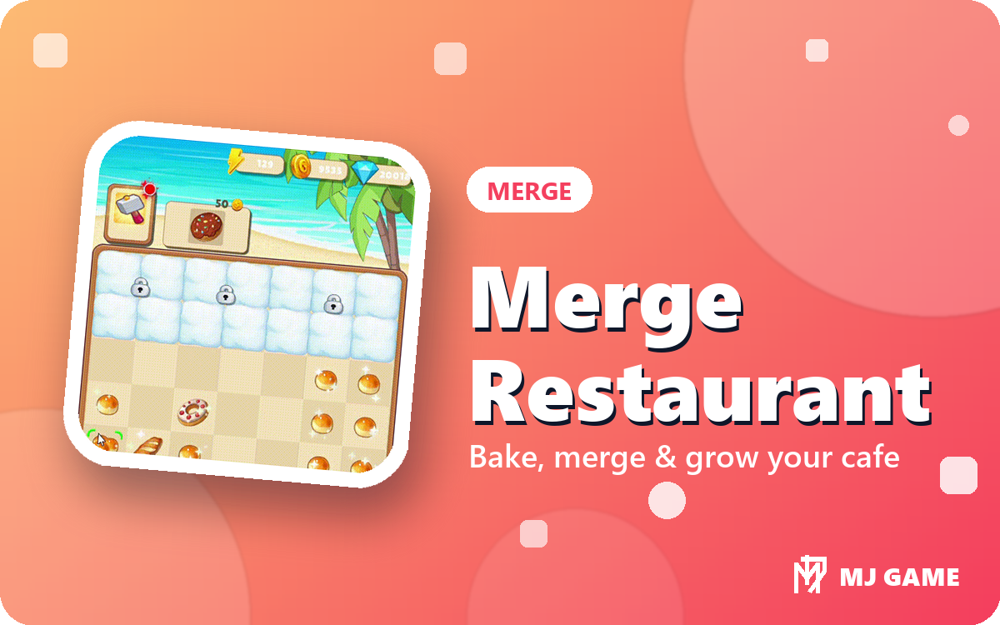
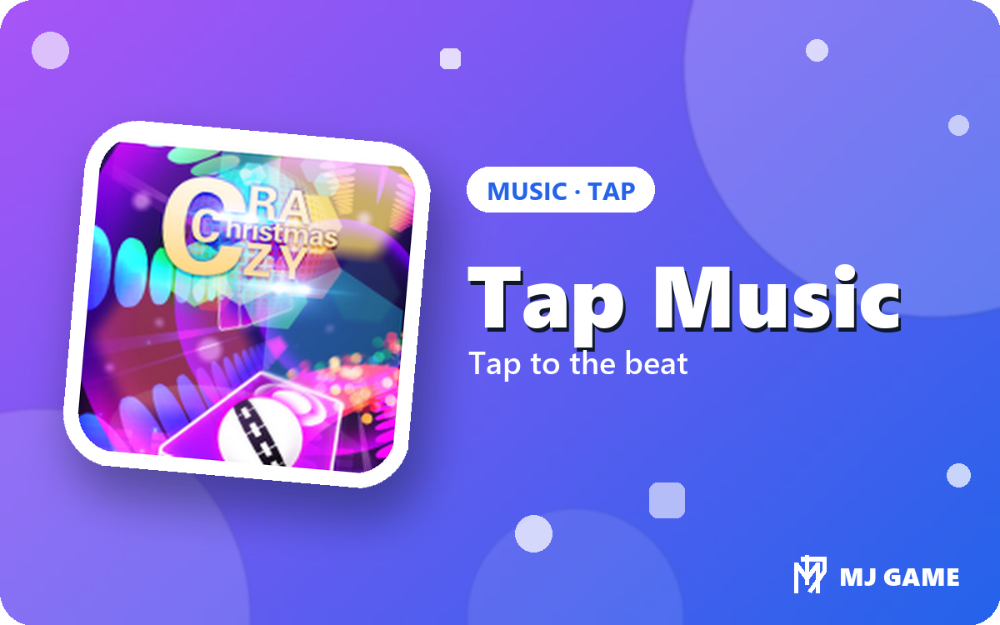
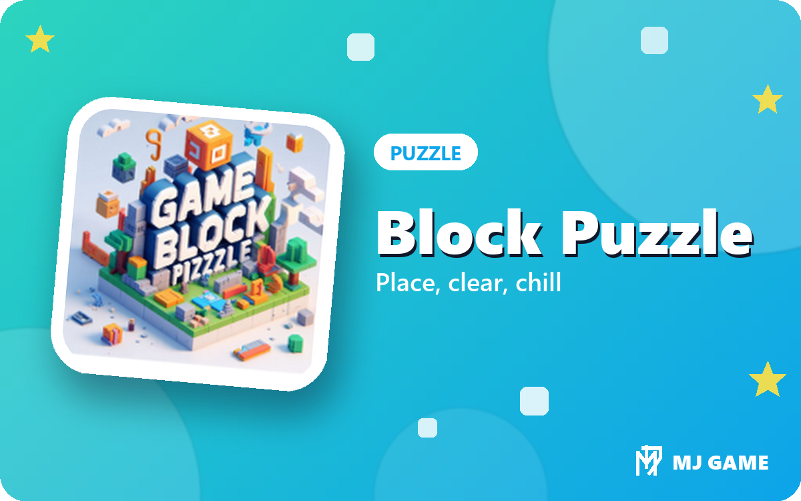
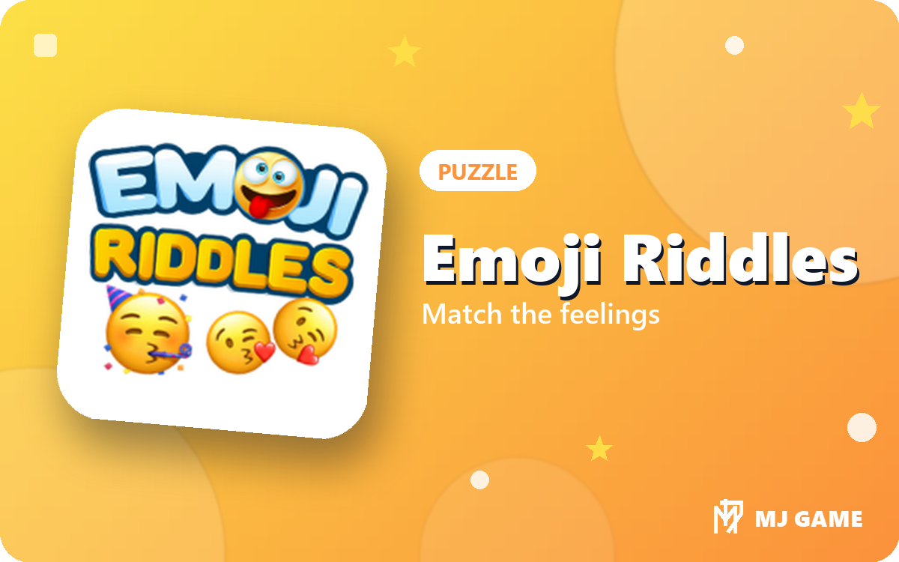
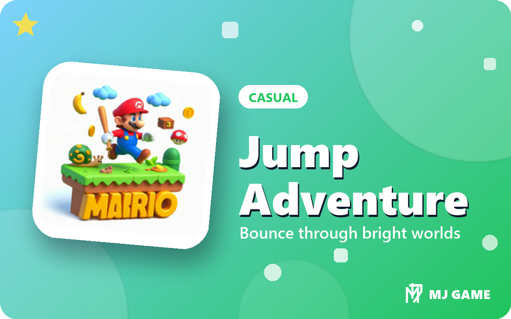

<!-- Header -->
<p align="center">
  <picture>
    <source media="(prefers-color-scheme: dark)" srcset="assets/banner/banner-dark.svg"/>
    
  </picture>
</p>

<p align="center">
  <a href="https://github.com/mindongun123">
    
  </a>
</p>

<p align="center">
  <a href="https://mindongun123.github.io/mindongun123/"></a>
  
</p>

---

## 🧙 Player Card


```yaml
Name:        Nguyen Minh Dong
Class:       Casual / Hyper-casual Game Developer
Born:        2003
Region:      Thanh Hoa, Vietnam
Main weapon: Unity + C#
Quest:       Build small games that feel juicy and keep players coming back
```

- 🎯 Fast hyper-casual prototypes, built to test CPI early
- 🍬 Game feel first: bounce, pop, squash & stretch, satisfying feedback
- 📈 Ads, IAP and analytics wired in from day one
- 📫 Reach me: **mindongun123@gmail.com**

<br clear="right"/>

## 🎒 Inventory

<p align="center">
  
</p>
<p align="center">
  
  
  
  
  
</p>

## 🕹️ Game Showcase

<table>
  <tr>
    <td align="center" width="33%">
      <a href="https://github.com/mindongun123/MJGame_APK/releases/tag/MatchKit"></a>
      <b>Match Kit</b><br/><sub>Match-3 · Android</sub><br/>
      <a href="https://github.com/mindongun123/MJGame_APK/releases/tag/MatchKit"></a>
    </td>
    <td align="center" width="33%">
      <a href="https://github.com/mindongun123/MergeRestaurant"></a>
      <b>Merge Restaurant</b><br/><sub>Merge · Casual</sub><br/>
      <a href="https://github.com/mindongun123/MergeRestaurant"></a>
    </td>
    <td align="center" width="33%">
      <a href="https://github.com/mindongun123/2024GB"></a>
      <b>Tap Music</b><br/><sub>Music / Tap · Hyper-casual</sub><br/>
      <a href="https://github.com/mindongun123/2024GB"></a>
    </td>
  </tr>
  <tr>
    <td align="center">
      <a href="https://github.com/mindongun123/MJGame_APK/releases/tag/MJGame_Block"></a>
      <b>Block Puzzle</b><br/><sub>Puzzle · Android</sub><br/>
      <a href="https://github.com/mindongun123/MJGame_APK/releases/tag/MJGame_Block"></a>
    </td>
    <td align="center">
      <a href="https://github.com/mindongun123/MJGame_APK/releases/tag/%23mjgameEmoji"></a>
      <b>Emoji Riddles</b><br/><sub>Puzzle · Casual</sub><br/>
      <a href="https://github.com/mindongun123/MJGame_APK/releases/tag/%23mjgameEmoji"></a>
    </td>
    <td align="center">
      <a href="https://github.com/mindongun123/MJGame_APK/releases/tag/MJGame_Mario"></a>
      <b>Jump Adventure</b><br/><sub>Casual platformer · Android</sub><br/>
      <a href="https://github.com/mindongun123/MJGame_APK/releases/tag/MJGame_Mario"></a>
    </td>
  </tr>
</table>

## 📊 Stats

<p align="center">
  <picture>
    <source media="(prefers-color-scheme: dark)" srcset="https://github-readme-stats.vercel.app/api?username=mindongun123&show_icons=true&hide_border=true&bg_color=0B1220&title_color=2DD4BF&icon_color=0EA5E9&text_color=E2E8F0"/>
    
  </picture>
  <picture>
    <source media="(prefers-color-scheme: dark)" srcset="https://github-readme-stats.vercel.app/api/top-langs/?username=mindongun123&layout=compact&hide_border=true&bg_color=0B1220&title_color=2DD4BF&text_color=E2E8F0"/>
    
  </picture>
</p>
<p align="center">
  <picture>
    <source media="(prefers-color-scheme: dark)" srcset="https://streak-stats.demolab.com?user=mindongun123&hide_border=true&background=0B1220&ring=2DD4BF&fire=0EA5E9&currStreakLabel=2DD4BF&sideLabels=E2E8F0&currStreakNum=E2E8F0&sideNums=E2E8F0&dates=94A3B8"/>
    
  </picture>
</p>

## 🏆 Achievements

<p align="center">
  
</p>

## 🐍 Contribution Snake

<p align="center">
  <picture>
    <source media="(prefers-color-scheme: dark)" srcset="https://raw.githubusercontent.com/mindongun123/mindongun123/output/snake-dark.svg"/>
    
  </picture>
</p>

<details>
  <summary><b>🎵 Fun facts</b></summary>
  <br/>

- 🎶 Favorite song: <a href="https://open.spotify.com/track/0NOOpNzTcrgMiKigtt9hXa"><i>산다는 건</i></a> by Hong Jin-young
- 🎤 Favorite group: <a href="https://www.youtube.com/channel/UCqwUnggBBct-AY2lAdI88jQ">BABYMONSTER</a>
- 🎬 Favorite actors: Kim Ji-won, Li Landi

</details>

## 📫 Connect

<p align="center">
  <a href="mailto:mindongun123@gmail.com"></a>
  <a href="https://facebook.com/md.6823"></a>
  <a href="https://github.com/mindongun123/MJGame_APK/releases"></a>
</p>

<!-- Footer -->
<p align="center">
  
</p>
